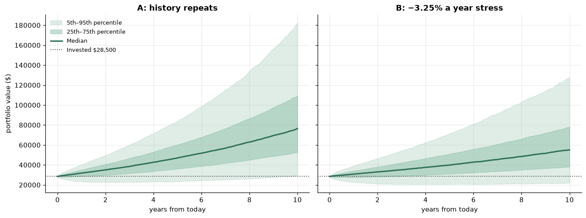
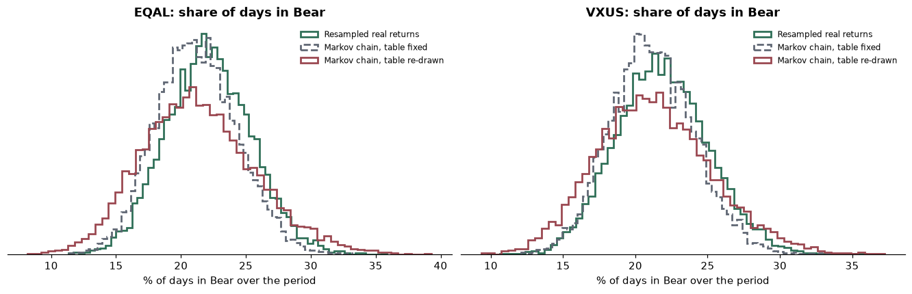

# Monte Carlo: EQAL + VXUS

Updated 2026-11-01 00:17 UTC · 10,000 simulated futures of 10 years (2,520 trading days) · seed 42 · blocks of 20 real days resampled from 2016-11-02 to 2026-10-30

## Setup

| Fund | Amount | Share of total |
|---|---|---|
| EQAL | $14,000 | 49.1% |
| VXUS | $14,500 | 50.9% |
| **Total** | **$28,500** | 100% |

Buy-and-hold: no rebalancing, no contributions or withdrawals, no taxes or costs. Prices are dividend-adjusted (total return). **Scenario A: history repeats.** **Scenario B: 3.25% a year is subtracted from every fund's return**, a stress case (my assumption, not a forecast).

For reference, the actual last 10.0 years of this exact mix: **10.0% a year**, worst fall **-38%**, $28,500 became $73,573.

## 1. Where $28,500 could end up

| After 10 years | A: history repeats | B: −3.25%/yr stress |
|---|---|---|
| 5th percentile value | $29,134 | $21,872 |
| 25th percentile value | $52,526 | $38,047 |
| 50th percentile value (median) | $76,464 | $55,113 |
| 75th percentile value | $109,504 | $78,257 |
| 95th percentile value | $182,497 | $127,800 |
| Median growth per year | 10.4% | 6.8% |
| Chance of ending below $28,500 (the amount invested) | 4.6% | 11.7% |
| Median worst fall along the way | -34% | -36% |
| Chance of a fall worse than −20% | 91% | 94% |
| Chance of a fall worse than −30% | 66% | 73% |
| Chance of a fall worse than −40% | 30% | 38% |

*No liability was entered. Add its amount and timing (for example $20,000 in 4 years) and rerun to get the chance of falling short.*

## 2. How many days in each regime

Over 2,520 trading days, how many would be Bear, Sideways and Bull. Each cell is the **5th – median – 95th** percentile, in days (out of 2,501 days that can be labelled).

### EQAL  ·  today: Bull

| Method | Bear days | Sideways days | Bull days |
|---|---|---|---|
| Resampled real returns, labelled with the 20-day ±2% rule | 423 – 552 – 690 | 777 – 888 – 1,002 | 907 – 1,058 – 1,212 |
| Markov chain, table fixed | 408 – 527 – 661 | 804 – 891 – 982 | 947 – 1,079 – 1,216 |
| Markov chain, table re-drawn each path | 367 – 527 – 725 | 767 – 890 – 1,016 | 890 – 1,076 – 1,265 |

### VXUS  ·  today: Bear

| Method | Bear days | Sideways days | Bull days |
|---|---|---|---|
| Resampled real returns, labelled with the 20-day ±2% rule | 418 – 545 – 680 | 840 – 952 – 1,062 | 853 – 1,002 – 1,154 |
| Markov chain, table fixed | 416 – 527 – 652 | 877 – 966 – 1,055 | 874 – 1,005 – 1,132 |
| Markov chain, table re-drawn each path | 380 – 528 – 706 | 839 – 962 – 1,088 | 829 – 1,005 – 1,190 |

**How to read the checks.** If the Markov-chain rows are close to the resampled-returns row, the transition table is a consistent summary of the data. The *re-drawn* row is wider because it admits that the table was estimated from only about ten years. Differences also come from the Markov chain forgetting any longer memory in real returns.

## 3. What this does and does not tell you

- It assumes the sampled decade is representative of the next ten years. A decade of strong stock returns will make Scenario A look good almost by construction; that is why Scenario B exists.
- Resampling blocks of 20 days keeps short-term momentum and the funds' co-movement, but not anything longer than a block.
- Results are ranges, not predictions. The extreme percentiles depend on rare events that a decade of data barely contains.
- No rebalancing, taxes, trading costs, currency effects on VXUS beyond what is in its price, withdrawals or contributions.

_Historical, not forward-looking._
